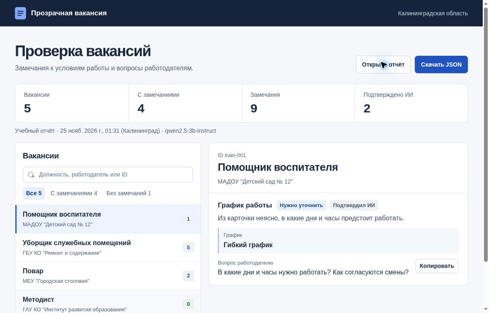

# Как устроена «Прозрачная вакансия»

## Зачем мы это сделали

Фраза «гибкий график» сама по себе мало помогает человеку, который выбирает работу. Возможно, дни и часы уже указаны в другом поле карточки. Программа собирает доступные сведения и показывает редактору только те вопросы, которые остались открытыми после проверки.

У редактора есть исходная фраза, объяснение и готовый вопрос работодателю. Например, «В какие дни и часы нужно работать? Как согласуются смены?» Редактор может скопировать этот вопрос или скачать весь отчёт в JSON.

## Откуда берутся данные и что с ними происходит

1. **Получаем вакансии.** Команда `run` обращается к API «Работа в России» по региону 39. Она читает страницы выдачи до настроенного лимита, сверяя ID, чтобы карточка не попала в отчёт дважды. Команда `verify` начинает с локального файла и дальше проходит ту же проверку.
2. **Собираем сведения из карточки.** Смотрим отдельно на должность, обязанности, требования, зарплату, график, адрес и занятость. Берём данные из описания и полей API.
3. **Сверяем по правилам.** Например, если в описании написано «до 30 000», а минимальная оплата указана как 40 000, программа записывает противоречие и сохраняет обе цитаты.
4. **Передаём модели спорные формулировки.** Она видит данные карточки и список возможных уточнений. Если часы уже есть в соседнем поле, вопрос про гибкий график можно снять. Модель возвращает номера подходящих вопросов. Текст вопроса и цитата берутся из программы и карточки.
5. **Сохраняем и показываем результат.** JSON содержит все обработанные вакансии, включая карточки без замечаний. В браузере тот же результат можно искать, фильтровать и скачивать.

## Что за что отвечает

| Часть проекта | Её работа |
| --- | --- |
| [Команды запуска](../src/cli.py) | Запускают ручной сбор, проверку файла, расписание и просмотр отчёта. |
| [Настройки](../config/config.json) | Хранят адрес API, лимиты, часовой пояс, расписание и параметры модели. |
| [Загрузка](../src/fetcher.py) | Запрашивает страницы портала, повторяет временно неудачные запросы и убирает дубликаты. |
| [Правила](../src/facts.py) | Собирают сведения из полей карточки, находят пропуски и противоречия, составляют вопросы. |
| [Анализатор](../src/analyzer.py) и [модели](../src/ai) | Проверяют с помощью ИИ, остались ли неясности, и принимают только допустимые номера вопросов. |
| [Сборка отчёта](../src/report.py) | Собирает JSON и заменяет файл только после записи нового результата. |
| [Просмотр в браузере](../src/view.py) и [интерфейс](../src/web) | Читают готовый отчёт и показывают его редактору. Базовый анализ запускается отдельной командой. |
| [Черновик резюме](../src/resume.py) | По желанию выделяет пункты вымышленного резюме, связанные с выбранной вакансией. |

## Что можно показать жюри

В [учебном отчёте](../data/reports/report_example.json) пять вакансий. Выберите помощника воспитателя, чтобы показать вопрос о гибком графике, повара, чтобы сравнить две суммы, и методиста, чтобы показать карточку без замечаний. Числа сверху относятся к открытой выборке.

Расписание настроено на 09:00 по Калининграду. Оно действует, пока запущена команда `schedule`. Если API недоступен даже после повторных попыток, предыдущий отчёт остаётся на диске, а интерфейс сообщает о сбое при открытии рабочего отчёта.

Замечания относятся к тексту карточки. Решение о том, что исправить, принимает редактор. Модель проверяет формулировки, которые правила вынесли на дополнительное рассмотрение. Сервис может пропустить неясность, если ни одно из правил не обратило на неё внимания.

## Что было проверено

- Запрос двух страниц живого API с обработкой четырёх карточек.
- Проверка пяти учебных карточек локальной Qwen 2.5. Два замечания прошли проверку ИИ.
- Сохранение предыдущего отчёта при сбое источника и остановка строгого режима при ошибке модели.
- Поиск, фильтры, копирование вопроса, открытие старого JSON и скачивание отчёта в браузере.
- Переход к одной колонке на узком экране без горизонтальной прокрутки.

Команды запуска и параметры модели описаны в [README](../README.md). Для репетиции показа подготовлен [план записи](demo_script.md).
